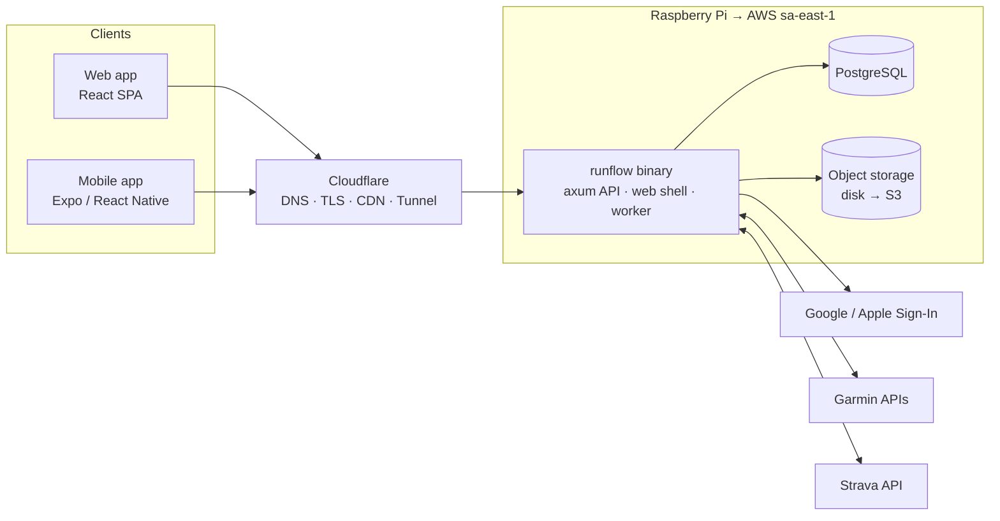

# Runflow: root

> **The single entry point for Runflow.** Every work session, human or agent, starts here.
> It holds the *intent* and the *cross-repo decisions* for the company and product.
> Implementation details live in each area's own `CLAUDE.md` and docs (`design/`, `backend/`, `frontend/`, `mobile/`).
>
> Domain: **runflow.club** · Market: **Brazil** · UI language: **Portuguese (pt-BR)** · Hosting: **São Paulo region**
> Status: **Phase 1: web app on the mock API** · Last updated: 2026-11-01

---

## 0. How to use this file

- **Always read §1–§4 and §9.** Then read the section for the area you're working in (§7.x) and the next item in §10.
- **One session = one work item** from §10. A session ends with the code working, tested and committed, and with §10 updated (status and session log).
- **Decisions are sticky.** Don't contradict the decision log (§9) silently. If a decision has to change, say why, update §9 and every section it affects in the same session.
- **This file stays an index, not an encyclopedia.** When a topic outgrows its section, move the detail into `docs/<area>/<topic>.md` in this repo and leave a summary and a link here. Keep this file under ~600 lines.
- The founder's original brief is kept verbatim in Appendix A. When something here is ambiguous, the brief is the tie-breaker for intent.

---

## 1. What Runflow is

Runflow is a **training platform that connects trainers and clubs with their students**, built for the Brazilian market.

- **Trainers and owners** prescribe workouts and training plans (*planilhas*), schedule classes, and follow how their students are doing.
- **Students** see what to do today, train, and their results sync back from **Strava** (Garmin later).
- **Every club sees its own colors.** Runflow is the app. The *Club Studio* lets a club set its logo and colors, and Runflow displays them to the club's members on web and mobile. This is included on the free tier.
- **More than running.** Runflow serves running clubs (*assessorias*) and also **gyms (scheduling)**, **swimming clubs**, and **hybrids** that mix modalities.

## 2. Why we win

We compete on three things. Each one is a commitment we measure, not a slogan.

| Pillar | Commitment (measured) |
|---|---|
| **UX**: easier than anything else | A trainer creates and assigns a structured workout in **< 30 s**. Planning a full week for a group takes **< 2 min**. A new owner goes from sign-up to a branded club with an invite link in **< 5 min**. A student sees today's workout within **1 tap** of opening the app. |
| **PRICE**: simply cheaper | Free for up to 10 students, with all features. Pro is **R$ 20/month for up to 100 students** (sisrun: R$ 99/month for 20 students, plus a R$ 79 activation fee). We can afford this because we run modern, lean infrastructure (Rust, one binary, Postgres) and build with agentic coding. |
| **SPEED**: never slow, never down | API p95 **< 100 ms** on reads. Web app interactive **< 1.5 s** on 4G on a mid-range Android. Mobile cold start **< 2 s**. Today's and this week's workouts work **offline**. Full budgets are in §7.7. |

Two structural differentiators sit on top of these:
1. **Multi-modality.** One platform covers prescription (running, swimming, cycling, strength) and scheduling (gym classes, swim lessons), so hybrid clubs stop paying for two tools.
2. **Club Studio.** Runflow displays each club's logo and colors, even on the free tier, and Pro adds a custom subdomain.

## 3. Competitive landscape: sisrun

Snapshot from sisrun.com.br (2026-11-01). Re-check before marketing claims.

- **Claims**: 2,000+ *assessorias* and 100,000+ students. It is focused on running.
- **Features**: online training spreadsheet, separate coach and student apps, financial management (students pay fees through the app), GPS sync with automatic feedback, exercise video library, race and event calendar, physical assessment, performance tests and protocols, polls, virtual challenges and races, and "AI features".
- **Pricing**: R$ 99/month for up to 20 students, plus a R$ 79 activation fee. Prepaid. Quarterly, semiannual and annual cycles are available. 7-day trial. Additional coaches cost nothing extra.
- **Support**: WhatsApp, email and a help center, Mon–Fri 08:00–18:00.
- **Not visible**: white-label or club branding, gym or class scheduling, and any modality beyond running.
- **Known pain points** (founder's view and our thesis): it is slow, it crashes, and its UX is dated.

**Our angle:** parity on the core coaching loop first, then win on speed, workout-creation UX, price, branding and modalities. We don't chase their long tail of features (polls, video library, assessments) until the core loop is clearly better.

---

## 4. Product

### 4.1 Customers and the two engines

| Customer | Main need | Engine |
|---|---|---|
| Running clubs (*assessorias de corrida*), triathlon, cycling | Individualized plans, watch sync, feedback | **Prescription** |
| Swimming clubs and schools | Swim sets plus lesson schedules (levels, lanes) | **Both** |
| Gyms and studios (functional, strength, pilates…) | Class schedule, bookings, capacity, check-in; sometimes strength programs | **Scheduling** (+ prescription) |
| Hybrid clubs | Any mix of the above | **Both** |

The product is built on two engines that a club can enable together:

- **Prescription engine (*planilha*).** A trainer builds structured workouts, assigns them to a student or group on a date, and the student executes. The completed activity syncs from the watch, is matched to the plan automatically, and the student adds feedback (RPE/*PSE*, comment). The trainer then reviews compliance.
- **Scheduling engine (*aulas*).** Recurring classes with capacity, instructor and location. Students book, join a waitlist, cancel, and check in (e.g. QR code at the gym). The trainer sees the roster and attendance.

### 4.2 Roles

Membership is **per club**. One person can be a student in club A and a trainer in club B, and the app switches context with a club switcher.

| Capability | Owner | Trainer | Student |
|---|:-:|:-:|:-:|
| Club Studio (logo, colors), subdomain, billing, subscription plan | ✓ | – | – |
| Invite or remove trainers; club settings | ✓ | – | – |
| Invite students; manage groups | ✓ | ✓ | – |
| Build workouts, library, *planilhas*; assign to students or groups | ✓ | ✓ | – |
| See students' synced activities, feedback, compliance | ✓ | ✓ | own only |
| Manage class schedule and rosters | ✓ | ✓ | – |
| Receive workouts, send to watch, give feedback, book classes, connect devices | – | – | ✓ |

Trainers see **all** students in their club (D-017). The owner is also a trainer by default.

### 4.3 Core features

**MVP: the coaching loop, running first.**
- **Workout builder (structured).** Steps (warm-up, active, recovery, cool-down, rest), repeats, durations (time, distance, open), and targets (pace, HR zone, power, RPE). The builder shows a live intensity chart.
- **Quick-text builder (signature feature).** The trainer types the way they'd write on WhatsApp, e.g. `10' aquec + 6x1km @4:30 c/ 2' trote + 10' desaq`, and gets a structured workout instantly. This is deterministic parsing of Brazilian coaching shorthand; AI is optional later.
- **Library.** Templates, plus copying a workout or week and pasting it onto other students.
- **Planning calendar (web).** Students × days grid. Drag and drop, assign to a group, copy a week.
- **Student "Hoje".** Today's workout, the week strip, and the last synced activity. *Send to watch* comes with Garmin (§5).
- **Auto-matching.** A synced activity is matched to the planned workout, with a compliance indicator, the student's RPE and comment, and a comment thread with the trainer.
- **Zones per student**, set from a test or a recent race result.
- **Week release.** Plan ahead in private, then unlock the week for everyone at once, by hand or on a schedule (D-031).
- **Club Studio** (§4.4), **invites** (§4.5) and **notifications** (push and email), each user choosing what reaches them and how (D-032).

**Next:** swim and strength builders (sets, send-off times, equipment; exercises, sets/reps/load), multi-week *planilhas*, groups, the scheduling engine, trainer analytics, billing.
**Later:** Garmin (activities and send to watch), Sign in with Apple and the iOS App Store release, club finances (students pay monthly fees, which is also a revenue lever for us), race and event calendar, challenges, AI assistant (plan suggestions, free-text-to-workout), Apple Health / Health Connect.

### 4.4 Club Studio (club theming)

**Runflow is the app; the club is the theme (D-018).** Club Studio doesn't build a separate app for each club. It changes how Runflow *displays* to that club's members: logo, colors and name. Store listings, sign-in and the product itself stay Runflow.

| Tier | What the club gets |
|---|---|
| **Free** | Club name, logo, and up to two colors (primary and an optional secondary). The colors theme the **signed-in** app on web and mobile for the club's members. Public pages (landing, sign-in, invite page) always stay in Runflow's brand and show only the club's logo and name, as do invite e-mails (D-024). |
| **Pro** | Everything in Free, plus a **`<club>.runflow.club`** subdomain that opens straight into the club's Runflow (themed once signed in). |

How theming works (D-014; details in `design/`):

| Club sets | Primary (*cor primária*): actions (buttons, active tab, links, focus) | Secondary (*cor secundária*): highlights (records, streaks, achievements) |
|---|---|---|
| nothing | Azul Flow (Runflow default) | Volt (Runflow default) |
| one color | the club's color | derived: same hue, opposite lightness (e.g. red → light coral). A neutral primary (black, white, gray) gets Volt. |
| two colors | the club's primary | the club's secondary |

- For each of the two colors, the engine derives a tonal scale and semantic roles (fill, text on fill, text color, subtle backgrounds, borders, focus ring) for **light and dark mode**. It works in OKLCH and **guarantees WCAG contrast**.
- The club's exact colors are kept for fills whenever possible. Text on a fill switches to white or dark automatically. If white text would fail on the primary, Club Studio suggests a slightly darker variant. If the secondary works better for buttons than the primary, it suggests swapping them.
- Uploading a logo suggests the primary and secondary from it. The Studio previews the result on a phone and a desktop mockup before saving.
- In code the two colors are the `brand` and `accent` tokens. "Secondary" is avoided as a token name because it already names the neutral secondary button.
- The same engine runs in the frontend (live preview), the mobile app (runtime theme) and the backend (stored on save, injected into HTML). Golden fixtures from `design/` keep all three identical. How a saved theme reaches the screen without a flash of Runflow's colors: §7.8.

### 4.5 Onboarding flows

Auth is **Sign in with Google** or an **email one-time code**. There are no passwords. **Sign in with Apple** comes with the Apple Developer account, before the iOS App Store release (D-007). **Joining a club needs a personal invite (D-023):** the owner or a trainer invites an e-mail address, Runflow e-mails a link that is valid for 7 days, works once, and only for the account with that e-mail. There are no club-wide or reusable links. Invites can be resent (new link, another 7 days) or cancelled, and a spreadsheet can be imported to invite many students at once.

1. **Owner creates a club** (target: under 5 minutes).
   - Landing page → "Criar meu clube grátis" → Google or email code → club name, modalities (icon multi-select), city.
   - **Studio quick step:** upload a logo, then pick or accept the suggested color, with a live preview.
   - **Invite step:** invite one person at a time (e-mail plus optional name); the form clears for the next and lists who was invited. Many at once is the spreadsheet import later (can be skipped).
   - **First workout:** pick from ready templates ("Rodagem leve 5 km", "Intervalado 6×1 km"…).
   - Dashboard with an onboarding checklist.
2. **Trainer invited by the owner:** e-mail invite → sign in with that e-mail → accept → lands on the student list.
3. **Student joins.**
   - The invite page (Runflow's brand, with the club's logo and name) says who invited them and to which e-mail ("Marcos te convidou").
   - Sign in with the invited e-mail (another account is told to switch).
   - **LGPD consent**, explicit and highlighted: share training and health data with the club's trainers.
   - Profile basics: name, birth date, goal (5k / 10k / 21k / 42k / triathlon / saúde…), and optionally a recent race time to set zones.
   - **Connect Strava** (Garmin later). Connecting asks for consent to share activities with the club's trainers (§5).
   - Install the app via a deep link, then land on "Hoje".
4. **Multi-club:** a club switcher appears whenever the user has more than one membership.
5. **Limits:** when a free club hits 10 students, the invite page says the club is full and the owner gets an upgrade nudge. **Existing students are never locked out.** We block new joins and give a grace period.
6. **Account deletion** is available in-app (an App Store requirement), along with data export (LGPD).

### 4.6 Pricing

| Plan | Students | Price | Notes |
|---|---|---|---|
| **Free** | up to 10 | R$ 0 | All features, Club Studio included. Marketed as generous. |
| **Pro** | up to 100 | **R$ 20/month** | All features plus a custom subdomain. Annual option to define. |
| **Max** | TBD | ~R$ 100/month + a small per-student fee | To be defined (§11). |
| **Enterprise** | — | Annual license | Self-hosted (same container + Postgres + S3-compatible storage). A small line of business. |

- **Counting rule:** only **active students** count. Owners and trainers are unlimited and free, which matches sisrun.
- **Billing: Stripe (D-016). We're not charging yet.** During the beta every club is free, but plan limits already work in the product. Invoicing (NFS-e) is handled by the founder, outside the product.
- **Future revenue:** a small take rate when clubs collect student fees through Runflow (later, D-027).

### 4.7 Language, locale, glossary

- **Everything user-facing is pt-BR by default (D-013):** the apps, the design system pages, mocks, emails, push notifications and **every error message, including the ones the backend returns**. It is i18n-ready from day one: no hardcoded UI strings. **Internals are English:** code, comments, commits, logs, `root.md` and docs.
- **Formats:** decimal comma (`10,2 km`), 24-hour time, `seg, 3 nov`, pace as `4:30 /km`, swim pace as `1:45 /100 m`, metric units. Each club has a timezone (default `America/Sao_Paulo`). Money is stored as integer centavos.
- **Tone:** close, motivating and direct. Use "você" and sentence case. Buttons are verbs ("Salvar treino", "Enviar para o relógio"). Portuguese runs about 20–30% longer than English, so layouts must allow for it.

| Code (EN) | UI (pt-BR) | Note |
|---|---|---|
| club | clube / assessoria | "clube" in the product; "assessoria" in running marketing |
| owner / trainer / student | gestor(a) / treinador(a) / aluno(a) | Clubs can relabel trainer as *professor(a)* (gyms, swimming) |
| workout / planned workout | treino / treino prescrito | |
| training plan | planilha | **Never write a bare `plan` in code.** Use `TrainingPlan` vs `SubscriptionPlan`. |
| template / library | modelo / biblioteca | |
| interval rep / recovery jog | tiro / trote | e.g. "6 tiros de 1 km" |
| warm-up / cool-down / easy / long run | aquecimento / desaquecimento / rodagem / longão | |
| RPE | PSE (percepção subjetiva de esforço) | |
| class / booking / waitlist | aula / reserva / lista de espera | |
| drill / kickboard / paddles / fins | educativo / prancha / palmar / nadadeira | swimming |
| sets / reps / load / rest | séries / repetições / carga / intervalo | strength |

---

## 5. Integrations

**Sync model (D-011).** Each student connects *their own* Strava account to Runflow (Garmin later). When they finish a session, the activity syncs by webhook into **Runflow's training model** and is matched to the planned workout. Trainers then see it inside Runflow.

| Provider | What we use | Constraint that shapes the product |
|---|---|---|
| **Garmin** (Connect Developer Program, free for approved businesses) | **Activity API**: completed activities sync into our training model (push/webhook). **Training API**: publish workouts and plans to the student's Garmin Connect calendar, which syncs to the watch. | **Deferred by the founder** (2026-11-01). The program costs nothing for approved businesses but needs an application, so the deferral is about timing, not cost. It's the only provider that can **send workouts to the watch**. Whether the official API accepts swim and strength workouts is unverified; confirm after approval. |
| **Strava** | Completed activities sync into our training model via webhook. This also covers athletes on Coros, Amazfit, Apple Watch, Polar and others who already auto-upload to Strava. | **Trainers see a student's Strava data only with that student's explicit consent.** The API Agreement (effective 2026-06-01) defines Strava Data as *"all data you access or collect from the Strava API Materials"*, so storing it in our DB doesn't change what it is. Its summary says a user's data *"can only be displayed or disclosed… to that user"*, then adds *"This includes not sharing a Strava user's data with other users, end users of your application, or third parties without explicit consent."* ⇒ We rely on explicit consent and **confirm the coaching use case in writing with Strava** during app review (needed anyway, since new apps start with a small athlete cap). Rate limits and brand guidelines apply. |

**Sync rules**
- **Consent.** Shown at connect time, per provider and per club, e.g. "Compartilhar minhas atividades do Strava com os treinadores do <Clube>". We log who, when, and which version of the text. Students can revoke it in settings, and trainers lose visibility immediately.
- **Provenance.** Every activity stores its `source` (`garmin | strava | manual | file`) and the consent it relies on. If a provider's terms change, we can change visibility per source without migrating data.
- **Disconnect.** Deauthorizing a provider deletes the raw data synced from it. The student's own inputs (RPE, comments) stay.
- **Deduplication (once Garmin is live).** Most Garmin users also auto-upload to Strava, so one session often arrives twice. Match on start time, duration and distance, and prefer the Garmin copy.

- **Extensibility.** A `Provider` abstraction covers connect, ingest activity, push workout, and disconnect/delete data. Next in line: **Apple Health (HealthKit)** and **Android Health Connect** through the mobile app (this also covers Apple Watch, Coros, Polar and others), FIT/GPX/TCX upload, and `.FIT` workout export.
- **Workout format.** Keep the internal workout structure compatible with the **FIT workout model**, so exporting to any device is a mapping rather than a redesign.
- **Respect each provider's terms in AI features.** Check a provider's terms before its data feeds any model.

---

## 6. Design direction

The design system lives in **`design/`**, a deliberately small package (§7.1). This section sets its intent. The founder approved the foundations (D1). Screens are now built directly as the real apps on a mock API (D-020, §6.1).

**Principles**
1. **Runflow is the app; the club is the theme.** Structure, components and voice are Runflow's everywhere. The club's logo and colors sit on top, so students feel at home in their club.
2. **Data is the hero.** Paces, distances and times are big, with tabular numerals.
3. **Thumb-first on mobile, keyboard-friendly on web.** Trainers plan on desktop; students live on their phones.
4. **Perceived speed is a feature.** Use optimistic updates and skeletons, and show a spinner only past 300 ms.
5. **Accessible by default:** WCAG 2.2 AA. The theming engine enforces contrast.
6. **One language, two platforms.** Web and mobile share the same tokens, component names, variants and states, and use platform-native patterns where they differ (dialog vs bottom sheet, sidebar vs tab bar).
7. **Light and dark mode from day one.** Athletes open the app at 5 a.m.

**Initial identity** (a proposal, to be finalized in `design/` with a showcase page)
- **Azul Flow `#4B4FE8`**: Runflow's default primary color, used by clubs that set no colors. White text on it is 5.9:1.
- **Volt `#CFF846`**: Runflow's default secondary color, for highlights only (records, streaks, achievements, the logo mark). Never used for text.
- **Ink**: cool neutrals (hue ~265) from near-white to near-black. Status colors are success, warning, danger and info.
- **Training zones Z1–Z5** follow the watch convention: gray `#9CACC1` → blue `#3496EF` → green `#3FC168` → orange `#F8962D` → red `#ED4042`. Data-viz only.
- **Sports:** run `#955BE3`, swim `#00A2C5`, bike `#E3AE28`, strength `#DB428C`, mobility `#26B094`. Always shown with an icon and label, never color alone.
- **Type:** **Archivo** for display (its variable *width* axis gives expanded, athletic headlines and big numbers) and **Inter** for UI (tabular figures). Fonts are self-hosted, with no Google Fonts CDN in production, for speed and LGPD.
- **Icons:** Lucide, which ships both React and React Native packages, plus custom sport icons on the same grid.
- **Spacing and shape:** 4 px spacing grid. Radii: 10 for controls, 14 for cards, 20 for sheets. Controls are 40 px tall on web and 48 px on mobile for primary actions.

### 6.1 Screens

The design system was approved after D1. The HTML-mock phase (D-015) was replaced by building the real web app, then the mobile app, against a mock API (D-020). **The full screen inventory, routes and build order live in [`docs/build-plan.md`](docs/build-plan.md).** Component pages (DS2/DS3) become a `/dev/components` route in the web app.

---

## 7. Architecture

### 7.1 Repository layout

**One repository for now:** [`github.com/otaviojacobi/runflow-future`](https://github.com/otaviojacobi/runflow-future). Each top-level folder is an **area** that maps 1:1 to a future standalone repo. Splitting one out must stay a mechanical operation (`git subtree split --prefix=<area>` or `git filter-repo --subdirectory-filter <area>`, which keeps history).

```
runflow-future/
├── root.md          ← this file: intent, decisions, roadmap
├── docker-compose.yaml, .env.example ← run Postgres + the API locally (and on the Pi, S8)
├── docs/            ← cross-cutting detail; docs/build-plan.md = screen-by-screen plan and status
├── api/             → the CONTRACT: schema.sql (DB) · endpoints.md (API) · mock/ (db.json + mock server)
├── ops/             ← Pi deployment, backups, restore runbooks (S8)
├── design/          → future runflow-design (package + showcase/ + mocks/)
├── backend/         → future runflow-backend
├── frontend/        → future runflow-frontend
└── mobile/          → future runflow-mobile
```

**Rules that keep areas splittable**
- Each area is self-contained: its own `CLAUDE.md`, its own `check` command, and its own CI workflow (GitHub Actions filtered by path).
- **No reaching into another area's source** (no `../backend/src/...` imports). Areas consume each other only through the contracts below: by package name, or through a generated artifact.
- Tooling at the repo root stays minimal. A JS workspace file linking `design`, `frontend` and `mobile` is fine. Shared build logic that would break a split is not.

| Area | Purpose | Stack | Consumes | Produces |
|---|---|---|---|---|
| **root** (`root.md`, `docs/`, `ops/`) | Intent, product/design/engineering basis, decision log, roadmap, deployment | Markdown, Docker Compose | Images and bundles from the areas | — |
| **`design/`** | **Small and framework-agnostic.** Design tokens (source of truth), the club-theme color engine, generated outputs, fonts, icons, a showcase page, and component *specs* (names, variants, states, anatomy). **No React or RN components**, because DOM and native primitives differ. Also holds `showcase/` and `mocks/` (§6.1), which aren't part of the published package. | `tokens.json` + a zero-dependency build | — | **`@runflow/design`** package: CSS variables, TS tokens, theme engine, assets. **Golden color fixtures** (JSON) for ports. |
| **`backend/`** | API, background worker, integrations, migrations. Serves the web-app shell with the club theme injected. | Rust · axum/tokio · sqlx · PostgreSQL | Golden color fixtures (to test the Rust theme port) | **OpenAPI 3.1 spec** (committed as `backend/openapi.json`). Multi-arch container image (arm64 + amd64) and a single binary. |
| **`api/`** | **The contract (D-020).** `schema.sql` (PostgreSQL), `endpoints.md` (REST catalog), `mock/` (a zero-dependency mock server over `db.json`). The apps are built against the mock; `backend/` implements the same contract later. | SQL, Markdown, Node (mock) | — | DB schema, API catalog, mock server on `:8787` |
| **`frontend/`** | Web app (trainer-heavy desktop, responsive for students). Later, the marketing site for `runflow.club`. | React · TypeScript · Vite (SPA) | `@runflow/design`, OpenAPI | Static bundle |
| **`mobile/`** | iOS and Android app (all roles in one app). | Expo (React Native) · TypeScript | `@runflow/design`, OpenAPI | Store builds and OTA updates |

**Contracts**
- **Design → apps:** the `@runflow/design` package, imported by **package name** (linked as a workspace package for now). After a split it becomes a published, versioned package and only the dependency line changes.
- **Backend → apps:** the OpenAPI spec. Each app generates its own typed client (`openapi-typescript`) from it. Prefer additive changes; breaking changes need a new version path.
- **Producer first.** A change that crosses areas lands in the producer (design or backend) first, then in consumers, ideally as separate commits.
- **No "shared" area until duplication actually hurts.** The likely first candidate is the quick-text workout parser. Alternatives: keep it in `frontend/`, or expose it as a backend endpoint.



### 7.2 Backend (`backend/`)

- **Rust, axum + tokio, sqlx + PostgreSQL.** Compile-time checked queries, with migrations managed by sqlx.
- **Modular monolith.** A Cargo workspace splits code into `domain` (pure types and rules, no I/O), `db`, `api`, `integrations` and `jobs`. One binary has subcommands `all | serve | migrate | doctor | email-test | healthcheck` (`worker` arrives with the job queue); Docker and the Pi run `all`. S1 ships `api`, `db`, `integrations` and the binary; `domain` and `jobs` come with the first step that needs them.
- **Background jobs** run on a Postgres queue (`FOR UPDATE SKIP LOCKED`). There is **no Redis**.
- **Object storage** goes through the `object_store` crate: local disk on the Pi, S3 in the cloud. Uploads are served from a separate host, images are resized server-side, and SVGs are sanitized or rasterized.
- **API conventions.** REST + JSON under `/v1`. OpenAPI is generated from code (utoipa). Errors follow RFC 9457 (problem+json): `title` and `detail` are **pt-BR**, written for the person who reads them, plus a stable English `code` (e.g. `workout.not_found`) for the apps to branch on. Server logs stay in English. Pagination uses cursors. IDs are UUIDv7. Timestamps are `timestamptz` in UTC. Workouts are scheduled on a **local date** plus the club's timezone.
- **Multi-tenancy.** One database with `club_id` on every club-scoped row. Club routes take the form `/v1/clubs/{club_id}/…`. An extractor checks membership and role on every request. Postgres RLS as defense-in-depth will be decided at bootstrap.
- **Workout structure** is stored as versioned JSONB, strongly typed in Rust: steps, repeats, durations and targets per sport, FIT-compatible.
- **Web shell.** For each host, the binary serves the SPA `index.html` with the club's theme CSS and name injected, so a club's subdomain never flashes Runflow's default colors. Hashed assets are cached at the CDN.
- **Lambda-ready.** No local state, config via environment variables, and `lambda_http` can wrap the same router later.
- **Observability:** `tracing` with JSON logs, Prometheus metrics, and Sentry-compatible error reporting.

### 7.3 Auth and authorization

- **Google (OIDC) + email one-time code now; Apple when the Apple Developer account exists. No passwords.**
- **Web.** Sign-in happens on the fixed host `app.runflow.club` (Google OAuth origins can't be wildcards): Google Identity Services gives the page an ID token, `POST /v1/auth/google` verifies it, and the server sets the session cookie. The session cookie is set on `.runflow.club` (HttpOnly, Secure, SameSite=Lax), which gives single sign-on across club subdomains. Custom domains (later) will use a one-time-code handoff.
- **Mobile.** The native Google sign-in SDK (Apple's later) returns an ID token. The backend verifies it against the provider's JWKS and issues an opaque session token, which the app keeps in secure storage and sends as a Bearer token.
- **Sessions.** Opaque random tokens, stored hashed and revocable. Web and mobile use the same model.
- **Apple requirements.** App Store guideline 4.8 requires a privacy-focused login next to Google, which Sign in with Apple satisfies. In-app account deletion is also mandatory. Both need the Apple Developer Program membership, which the founder has deferred, so the iOS App Store release waits for it.
- **Authorization** is checked server-side on every request, from the membership's role in the target club (§4.2).

### 7.4 Web frontend (`frontend/`)

- **React + TypeScript + Vite SPA**, with TanStack Router and TanStack Query.
- **Styling:** Tailwind CSS v4 bound to the `@runflow/design` CSS variables. Accessible primitives come from Radix or React Aria.
- **Forms and text:** react-hook-form + zod; i18next with a pt-BR catalog.
- **No SSR and no Node server in production.** The Rust binary and the CDN serve everything, and SEO only matters for the marketing site, which is a separate static build.
- **Budgets:** ≤ 200 KB gzip initial JS on student routes, with code splitting per route.
- **Why not Next.js:** it would need a Node runtime on the Pi and a second backend. An app behind login doesn't need SSR.

### 7.5 Mobile (`mobile/`)

- **Expo (React Native, new architecture) + TypeScript + Expo Router.**
- **One app for all roles,** with navigation that depends on the role. sisrun ships two apps.
- **Theming:** the club theme is applied at runtime from the `@runflow/design` engine.
- **Offline first:** today's and this week's workouts are cached (persisted query cache).
- **Platform features:** push notifications, native Google sign-in (Apple later), EAS Build and OTA updates. HealthKit and Health Connect come later.
- **Stores:** Android ships first. The iOS App Store release waits for the Apple Developer account (D-007).
- **Why Expo over Flutter:**
  - It shares TypeScript, tokens and the generated API types with the web app.
  - It is fast with the new architecture and Hermes.
  - OTA updates let us ship fixes quickly.
  - Agents are very fluent in it.
- **Styling (D-021):** React Native `StyleSheet` plus a typed theme built from `@runflow/design` tokens; club roles come from the same color engine at runtime. No NativeWind or Unistyles.

### 7.6 Infrastructure and hosting

| Phase | Setup |
|---|---|
| **A: now** | **Raspberry Pi 5** (8–16 GB) on an **NVMe SSD** (never an SD card), with a UPS. Docker Compose runs the `runflow` binary, PostgreSQL and on-disk object storage. Traffic comes in through a **Cloudflare Tunnel**: no open ports, it works behind ISP CGNAT (common in Brazil), and the free certificate covers `*.runflow.club`. Backups: continuous WAL archiving plus a nightly base backup to off-site object storage, with a **monthly restore drill**. CI builds multi-arch images and pushes them to GHCR. |
| **B: cloud** | **AWS sa-east-1 (São Paulo)**. RDS or Aurora PostgreSQL, S3 + CloudFront, and the API on ECS Fargate Graviton (arm64, the same architecture as the Pi) or Lambda. E-mail stays on Resend (D-026) or moves to SES. |
| **Enterprise** | The same image, Postgres, and any S3-compatible store, shipped as a docker-compose bundle with a license key. |

- **When to move to the cloud:** before promising any paid SLA, or at roughly 20 paying clubs, 2,000 weekly active students, or Pi CPU sustained above 60%, whichever comes first.
- **Honest risk:** a home Pi is a single point of failure, and reliability is one of our pillars. A tested "restore to cloud in < 2 h" runbook is mandatory before paid launch.

### 7.7 Non-functional requirements

| Area | Target |
|---|---|
| API latency | p95 < 100 ms (reads), < 250 ms (writes) at the edge of our host |
| Web | Interactive < 1.5 s on 4G on a mid-range Android. ≤ 200 KB gzip initial JS (student routes). |
| Mobile | Cold start < 2 s. Today's and this week's workouts offline. 60 fps lists. |
| Availability | 99.5% on the Pi (beta), 99.9% in the cloud. RPO ≤ 5 min, RTO ≤ 2 h. |
| Security | Provider tokens encrypted at rest, secrets only in the environment, rate limiting, audit log for owner and admin actions, no user-uploaded active content (SVG sanitized). |
| LGPD | Health data is **sensitive personal data** (art. 11), so we need explicit consent, export and deletion, and a published DPO (*encarregado*). The club is the controller of its students' training data and Runflow is the operator, which the terms and DPA must reflect. Data stays in Brazil. |

### 7.8 Club theme delivery (no flash of Runflow colors)

**What's stored.** The DB keeps only what the owner chose: `primary` and `secondary` (each optional), the logo asset and the club name. Alongside them it keeps `theme_rev` (bumped on every save) and `engine_version`. On save, the backend runs its Rust port of the color engine, checked against `design/dist/color-fixtures.json`. It stores the result next to the inputs: the resolved colors, every role for light and dark as JSON, and the ready-made CSS block. Clients never recompute a saved theme; they only run the engine for Club Studio's live preview. Fonts, spacing, components and data colors are not in the DB. They ship with the apps (§4.4, D-018).

**API.** `GET /v1/clubs/{id}/theme` returns `{ rev, primary, secondary, source, logo, css, roles: { light, dark } }` with `ETag: "<rev>"`, so most refreshes are a `304`. The same payload is embedded per membership in `GET /v1/me`, so the apps have every club's theme right after login without extra calls. Logo URLs are content-hashed and cached forever.

**Web: the first paint is already themed.**
1. **Club subdomain** (`<club>.runflow.club`, Pro). The binary already serves `index.html` per host (§7.2), so it inlines the club's stored CSS and name in `<head>`. No cache is involved.
2. **Shared host** (`app.runflow.club`). A small, non-secret `rf_club` cookie remembers the last active club, and the server inlines that club's theme the same way. Without the cookie, a tiny inline script applies the theme saved in `localStorage` before the first paint. This is the same trick that avoids a dark-mode flash.
3. **Public pages** (landing, sign-in, invite page, club picker, club creation) always render in Runflow's brand (D-024): the cached club stylesheet is present but disabled on those paths, so entering the app switches to the club's colors instantly.
4. **Revalidation.** After load the app checks the theme's ETag. If `rev` changed, it swaps the CSS variables in place, with no reload.

**Mobile: the first frame is already themed.**
1. The active club's theme (colors and `rev`) is persisted in a synchronous key-value store (`expo-sqlite/kv-store`, D-022), read before the first frame. The logo stays in the image disk cache.
2. The native splash screen (Runflow's, since Runflow is the app) stays up until the session and the cached theme are loaded, which takes milliseconds. The first rendered frame has the club's colors.
3. On launch and on returning to the foreground, the app revalidates with the ETag and applies a changed theme live, without a restart.
4. A fresh login with no cache gets every theme inside `GET /v1/me` before the home screen renders.

**Club switch:** themes for all of a user's clubs are cached, so switching is instant and works offline.
**Engine changes:** a new `engine_version` triggers a background job that recomputes every stored theme and bumps `theme_rev`. Clients pick it up on their next revalidation.

---

## 8. Engineering conventions (all repos)

- Every area has a `CLAUDE.md`, a single `check` command (format, lint, typecheck, test), and CI that must pass before merge.
- **No AI attribution in git history.** Commits and PRs never carry `Co-Authored-By:` trailers for AI tools, "Generated with …" footers, or any other mention of an assistant as author or contributor. The founder is the only author.
- **Never hardcode colors, spacing, radii, fonts or durations.** Always use `@runflow/design` tokens.
- **Never hardcode UI text.** Use i18n keys with pt-BR as the source language. Error messages are UI text too, including backend errors (§4.7, §7.2).
- Small commits and PRs (conventional commits). Each session leaves the repo in a working state.
- Tests: the backend tests against a real Postgres (no DB mocks). Web uses component tests plus Playwright e2e. Mobile uses component tests plus Maestro e2e.
- Performance budgets from §7.7 become automated checks as soon as the code exists.
- New dependencies need a one-line justification. Architectural changes update §9.

---

## 9. Decision log

| # | Decision | Why | Status |
|---|---|---|---|
| D-001 | Single repo for now ([runflow-future](https://github.com/otaviojacobi/runflow-future)), with top-level areas `design/`, `backend/`, `frontend/`, `mobile/` that map 1:1 to future repos | Simplest to start; atomic cross-area changes; small contexts per area for agents; a mechanical split later (§7.1) | Accepted (founder) |
| D-002 | Backend in Rust (axum/tokio) + PostgreSQL (sqlx) | Speed, low cost per user, runs on a Pi, maps cleanly to AWS | Accepted (founder) |
| D-003 | `design/` is small and framework-agnostic: tokens + theme engine + assets + specs, no components | Both apps consume it; DOM and RN components can't be shared well | Accepted (founder) |
| D-004 | Web: React + TS + Vite SPA, no SSR | No Node server in production; app is behind login | Proposed |
| D-005 | Mobile: Expo (React Native) + TS, one app for all roles | Fast, shares TS/tokens/types with web, OTA updates | Proposed |
| D-006 | Contracts: `@runflow/design` package (design), OpenAPI (backend); no cross-area source imports | Typed boundaries that survive a repo split | Proposed |
| D-007 | Auth: Google + email code now; Apple when the Apple Developer account exists (before the iOS App Store release); opaque hashed sessions; no passwords | Best UX, revocable; the founder deferred the Apple account | Accepted (founder) |
| D-008 | Multi-tenancy: shared DB, `club_id` scoping, per-club roles | Simple, cheap, supports multi-club users | Proposed |
| D-009 | Jobs on Postgres; no Redis | One fewer service on the Pi | Proposed |
| D-010 | Object storage via `object_store`: disk (Pi) → S3 (cloud) | Zero extra services now, config-only migration | Proposed |
| D-011 | Students connect their own provider accounts (**Strava at launch; Garmin deferred**). Activities sync into Runflow's training model, and trainers see them with the student's explicit, per-club, revocable consent. Provenance is kept per activity. | Founder's sync model. Strava's agreement forbids sharing with other users *without explicit consent* | Accepted (founder); confirm with Strava in writing |
| D-012 | Hosting: Pi + Cloudflare Tunnel → AWS sa-east-1 | Near-zero cost now; Brazilian data residency | Accepted (founder) |
| D-013 | Everything user-facing is pt-BR by default: apps, design system pages, mocks, emails, notifications and all error messages, backend included. i18n-ready. Code, comments, commits, logs and docs in English | Market focus without future rewrites | Accepted (founder) |
| D-014 | Club theming takes 0, 1 or 2 colors (none: Runflow defaults; one: derived secondary; two: primary + secondary) and produces an accessible light/dark theme. Same engine in all areas (golden fixtures) | Most clubs have two colors; contrast and coherence are never left to chance | Accepted (founder) |
| D-015 | Design first ("waterfall"): mock the whole UI as HTML before implementing | Validate look and flows cheaply | **Superseded by D-020** after D1 approval |
| D-020 | Contract first: `api/schema.sql` + `api/endpoints.md` + a mock server over `api/mock/db.json`. Build the real web app on it screen by screen, then the Rust backend implements the same contract, then mobile (order per D-025) | Real, testable UI early; the backend can't drift from what the screens need | Accepted (founder) |
| D-021 | Mobile styling: `StyleSheet` + a typed theme generated from `@runflow/design` tokens (club roles via the shared color engine) | One token source with the web, no styling dependency, works in Expo Go | Accepted (engineering, 2026-11-02) |
| D-022 | Mobile caches: club theme and preferences in `expo-sqlite/kv-store` (synchronous, in Expo Go); session token in `expo-secure-store`. Web preview uses `localStorage` | MMKV needs a custom dev build; the kv-store keeps the first frame themed without one | Accepted (engineering, 2026-11-02) |
| D-023 | Joining needs a **personal invite**: one per e-mail, sent by e-mail, valid 7 days, single use, and only the account with that e-mail can accept. No club-wide or reusable links, invite QR codes or WhatsApp sharing | Founder: invites must not be permanent and must be tied to the invited person | Accepted (founder, 2026-11-02) |
| D-025 | **Backend before mobile.** Phase 2 is the Rust backend implementing the whole contract (everything the web app does on the mock); mobile follows on the real API | Validates the 55-table contract on a real database before more clients depend on it; real sign-in, e-mail, Strava and Stripe need a server; mobile skips mock-only work | Accepted (founder, 2026-11-02) |
| D-026 | Transactional e-mail (sign-in codes, invites, notices) via **Resend**, behind an `EmailSender` trait; without an API key the backend logs e-mails instead (dev). Config only in `.env` | Founder has an account; simple API; swappable (SES in the cloud phase) | Accepted (founder, 2026-11-02) |
| D-027 | **No club-fee payments in v1.** Students don't pay their club through Runflow; clubs keep collecting fees their own way. Fee plans, charges, checkout and receipts (built in F26) are on the later list | Founder: too much for a first version (Stripe Connect onboarding, money flows, support) | Accepted (founder, 2026-11-02) |
| D-028 | **QA = the beta environment on the founder's Raspberry Pi**, at `qa.runflow.club` (`runflow.club` redirects there, 302). Cloudflare DNS + Tunnel; the web container serves the app and proxies `/api` (same origin); arm64 images from GitHub Actions; the Pi pulls `:qa` every 5 minutes. After the beta: a cloud (maybe k8s) | Founder, 2026-11-02 | Accepted (founder, 2026-11-02) |
| D-029 | **QA club subdomains are one level: `<club>-qa.runflow.club`** (not `<club>.qa.runflow.club`). Production never accepts a club subdomain ending in `-qa` | Cloudflare's free certificate covers only `*.runflow.club`; two levels need ACM (US$10/month). The suffix keeps QA and production apart | Accepted (founder, 2026-11-02) |
| D-030 | **Data is disposable until the private beta.** QA can be wiped at any time (`ops/qa/reset-db.sh`); migrations may drop and recreate instead of preserving data, and don't need to keep the previous release working. Before the beta: squash migrations into one baseline and return to expand-then-contract (`docs/hosting.md` §3) | Founder (2026-11-02): "everything for now is discardable"; speed over migration ceremony while nobody depends on the data | Accepted (founder) |
| D-031 | **Week release ("liberar semana").** Trainers plan ahead in private and unlock a week when it's ready: a club setting chooses `immediate` (visible on save, as before) or `weekly` (future weeks stay drafts until released, per week for everyone or chosen groups/students, or automatically at a club-set weekday and time, default Sunday 18:00). A week that has started is always visible. Drafts never reach the student (Hoje, Agenda, `.ics`, notifications, auto-matching); a release sends one `week_released` notification per student instead of one per workout. Detail in F34 | Founder (2026-11-02): trainers want to do all the training and "unlock" it at the end of each week. Defaults are an engineering proposal | Accepted (founder intent) |
| D-032 | **Notification control for every user.** Per notification kind: in-app, push and e-mail on/off, and "instant" or a daily digest; quiet hours for push; trainers can limit feedback/comment notices to chosen groups. Role-aware defaults: students instant, trainers get feedback/comments/new members as a digest. Replaces the four booleans in `notification_prefs`. Detail in F35 | Founder (2026-11-02): a big club easily overwhelms a trainer | Accepted (founder intent) |
| D-033 | **Observability:** errors to Sentry (backend, web, later mobile; DSN set by the founder; user id only, no personal data); metrics and logs with Prometheus (`/metrics` on an internal port, never through the tunnel), Loki and Grafana, as an optional compose profile on the Pi or Grafana Cloud's free tier. Steps S12–S13 | Founder (2026-11-02): needed before real clubs, can come after the product steps | Accepted (founder) |
| D-034 | **Smoke tests against deployed environments.** A small Playwright suite runs the main loop against QA after every deploy (and production later): sign in, create a throwaway club, invite and accept a student, assign and release a week, the student sees and completes it, the trainer sees the feedback, the club is deleted. Sign-in uses accounts on `smoke.runflow.club` (never delivered): with the secret `SMOKE_KEY` header the API returns their code instead of e-mailing it. Step S11 | Founder (2026-11-02): know the main operation works where people use it, not only in CI | Accepted (founder) |
| D-024 | Public pages are **always Runflow's brand** (landing, sign-in, invite page, club picker, club creation); the club's colors apply only inside the signed-in app (web and mobile) | Founder: the marketing site and sign-in are ours | Accepted (founder, 2026-11-02) |
| D-016 | Payments via Stripe; no charging during the beta; NFS-e handled by the founder outside the product | Founder decision | Accepted (founder) |
| D-017 | Trainers see all students in their club | Simple default; per-trainer assignment can come later if clubs ask | Accepted (founder) |
| D-019 | Club themes: the DB stores the owner's choices plus the theme derived at save time. Web inlines it in the HTML; mobile caches it on the device; both revalidate by `rev`/ETag (§7.8) | The first paint is already in the club's colors; one engine run per save, not per request | Proposed |
| D-018 | Runflow is the app; clubs theme it. No white-label apps, no club-branded store apps or PWAs, no "feito com Runflow" marks | Runflow is the product, just flexible in how it displays | Accepted (founder) |

"Proposed" means the default we build on unless the founder objects. A Proposed entry flips to Accepted when the founder confirms it or when the first implementation ships.

---

## 10. Roadmap and session plan

**Phases**
| Phase | Goal | Status |
|---|---|---|
| **0: Design system** | Tokens, club-theme engine, foundations page | **Done.** D1 approved by the founder (2026-11-01) |
| **1: Web app on the mock API** | Every screen, wired to the mock: auth, onboarding, coaching loop, library, planilhas, classes, Club Studio, billing (Stripe mock), account | **Done** (F0–F32) |
| **2: Real backend** | Rust API on PostgreSQL implementing the whole contract; Docker Compose; Pi deployment (D-025); founder priorities of 2026-11-02 (logo, week release, notification control, smoke tests, observability) | S1–S5 + QA done. **Next:** B1, F34, F35, S9, S11, then S6–S8, S12–S13 (`docs/build-plan.md`) |
| **3: Mobile app** | Expo app mirroring the web flows, on the real API | X0 done; X1–X10 after Phase 2 |
| **4: Private beta** | Friendly running clubs; Strava app review; LGPD texts | — |
| **5: Public launch** | Stripe live (Pro), subdomains, cloud migration plan | — |
| **6: Growth** | Garmin, Sign in with Apple + iOS App Store, club finances, events, challenges, AI assistant, Apple Health / Health Connect, Max, Enterprise | — |

**Next step:** the first unchecked row in `docs/build-plan.md`. Each step ends with its box ticked, the checks green, and a commit pushed.

**Session log**
- 2026-11-01. S0: `root.md` created. Researched sisrun pricing and features, the Strava API Agreement (2026-06-01), and the Garmin developer program. A prototype of the club-theme color engine exists and will seed S1.
- 2026-11-01. Founder set the provider sync model (D-011): students connect their own accounts and activities sync into Runflow's training model for trainers. A re-read of Strava's agreement confirmed that sharing needs explicit consent. Ran `git init` on the root.
- 2026-11-01. Founder created a single repo, `github.com/otaviojacobi/runflow-future`, for all code, with areas splittable into repos later (D-001 replaces the submodule plan). Added the rule against AI attribution in commits (§8). First commit pushed.
- 2026-11-01. **D1 delivered, in founder review.** `design/` has the tokens, the color engine, `build.mjs --check`, self-hosted fonts, CI, and the foundations page in pt-BR (`node design/serve.mjs`, then http://localhost:8080). Founder decisions made during the review: everything user-facing is pt-BR, including the design system and all error messages (D-013); clubs can set 0, 1 or 2 colors (D-014); club themes are stored in the DB and delivered without a flash of Runflow colors (D-019, §7.8).
- 2026-11-01. **Founder approved the design system (D1).** New approach (D-020): contract first (`api/schema.sql` validated on PostgreSQL 18, `api/endpoints.md`), then the real web app on a mock API screen by screen, then mobile, then the Rust backend. Plan and status: `docs/build-plan.md`. The founder authorized committing and pushing after each step.
- 2026-11-02. **Phase 1 (web app on the mock API) complete: F0–F30 and F20 hardening.** Beyond the core screens it covers classes, races, messages and mural, assessments, challenges, reports, club finances, an assistant (provider-agnostic contract, rules engine in the mock; open question §11.4), the exercise library, imports/exports (CSV, .FIT, .ics), command palette and an installable PWA. Contract: 55 tables in `api/schema.sql`. Quality gates: `npm run check` (incl. a 200 KB initial-JS budget) and `npm run e2e` (flows, axe WCAG AA, 360 px layouts) in CI. Design change: `fg.subtle` now meets 4.5:1 (new neutral steps 450/550) because it carries meta text. Next: Phase 2 (mobile, X0).
- 2026-11-02. Founder decisions: personal e-mail invites, 7 days, single use, bound to the invited e-mail (D-023, replaces the shareable link/QR/WhatsApp invites of §4.5); public pages always in Runflow's brand (D-024). Mobile X0 scaffold delivered (D-021, D-022).
- 2026-11-02. Founder decisions: backend before mobile (D-025: Phase 2 is now the Rust backend, mobile is Phase 3 on the real API); e-mail via Resend (D-026); workout hashtags first-class (F32); `.xlsx`/`.xls` import recorded as a later TODO (CSV covers it now). The invite form now sends one person at a time.
- 2026-11-02. **S1 backend bootstrap.** Cargo workspace (`runflow` binary + `api`, `db`, `integrations`), `/v1/health`, pt-BR problem+json, config from env with every variable in `.env.example` (local `.env` git-ignored), migrations starting from `api/schema.sql` with a test proving they build the same database, Resend e-mail with a log fallback (D-026) and a token-based layout, Dockerfile, root `docker-compose.yaml` (Postgres 18 :5433 + API :3000), backend CI. `npm run check` now covers the backend.
- 2026-11-02. **S2 auth.** E-mail codes through Resend (HMAC-hashed, bound to the address, rate-limited), Google ID tokens verified against Google's keys (no client secret needed), opaque SHA-256-hashed sessions as Bearer or HttpOnly cookie, the `/me` family (profile, LGPD delete and export, prefs, consents, notifications, sessions). Queries are compile-time checked (`sqlx::query!`, offline data committed). The mock now anonymizes deleted accounts and restricts `avatar_url` like the backend. New step S9: switch the web app to the real backend.
- 2026-11-02. Founder decision: no club-fee payments in v1 (D-027). F26 (club finances) removed from the web app, mock, contract and schema (F33; backend migration `0002` drops its tables) and moved to the later list.
- 2026-11-02. **S3 clubs, branding, invites, members.** Rust color engine reproduces the design fixtures byte for byte (fixtures now include the stored theme and CSS); the starter library became a contract artifact (`api/starter-library.json`); uploads through `object_store` (disk now, S3 later) with type sniffing and a sandboxing CSP; the Postgres job queue and `worker` (in-process with `all`) send invite e-mails with retries; members, groups and leaving match the mock. Founder's hosting options recorded in `docs/hosting.md`.
- 2026-11-02. **S4 coaching core.** Typed workout structures (every seed structure validates), template and exercise libraries (global catalog as a contract artifact), planned workouts and planilhas, the student side with personal zone targets and auto-matched completions, threads and the feedback inbox, the `.ics` feed, athlete summaries/detail/profiles/zones, and the dashboard. Docker Desktop kept stopping on the dev machine, so the session used the native Docker engine (`DOCKER_CONTEXT=default`).
- 2026-11-02. **S5 Strava.** OAuth (signed state, encrypted tokens), background sync and webhooks via the job queue, refresh, deauthorization and disconnect per §5, own activities; all tested against a fake Strava server.
- 2026-11-02. **QA on the Pi** (D-028): `setup-todo.md` is the founder's setup guide; images build on every push; `ops/qa/` runs Postgres, API + worker, web (Caddy) and the Cloudflare tunnel. Club subdomains need the web shell (S9); in QA they are `<club>-qa.runflow.club` (D-029).
- 2026-11-02. **QA live** at qa.runflow.club (API ~1 ms on the Pi, ~30 ms through the tunnel; the web app from Cloudflare's edge, S8b). Founder priorities: logo redo (B1: concepts on `/dev/logo`, B1b applies the pick), week release (D-031, F34), notification control (D-032, F35), smoke tests on deployed environments (D-034, S11), observability with Sentry + Prometheus/Loki/Grafana (D-033, S12–S13), and data disposable until the beta (D-030). `setup-todo.md` now lists only the open setup steps; the full QA guide moved to `docs/ops/qa-pi.md`.
- 2026-11-01. Founder decisions: design-first Phase 0 with the full UI mocked before implementation (D-015); Stripe, no charging during the beta, NFS-e outside the product (D-016); trainers see all students (D-017); Runflow is the app and clubs only theme it (D-018); Apple and Garmin developer programs deferred (D-007, D-011); no guardian accounts. Added the screen inventory (§6.1) and `CLAUDE.md`. Roadmap renumbered: Phase 0 is now design and validation, and **D1 is next**.

---

## 11. Open questions and deferred items

**Open**
1. **Max plan.** Student cap, price, and per-student fee.
2. **Strava written confirmation.** In Strava's app review, describe the coaching use case (students consent to share with their club's trainers) and keep the reply on file. Do this before inviting real clubs.
3. **Brand.** Palette and type approved in D1. **The logo needs a redo** (founder, 2026-11-02): concepts in step B1, the founder picks one.
4. **AI provider and budget (F27).** The assistant's contract is provider-agnostic and the mock is a rules engine. Before the backend's assistant endpoints (S-phase) pick the LLM (e.g. Claude via the Anthropic API), the per-club monthly cap per plan, and what student data may be sent (LGPD: only the club's own data, never health notes without consent).

**Deferred by the founder (2026-11-01)**
- Apple Developer Program: blocks Sign in with Apple and the iOS App Store release.
- Garmin Connect Developer Program: blocks Garmin sync and send-to-watch. It costs nothing, but needs an application and approval.
- Charging customers: Stripe goes live in Phase 5. NFS-e stays outside the product.
- Guardian accounts for minors: not planned.
- Pi management and deploys (founder deciding): recommended Raspberry Pi OS + Docker + Tailscale + GitHub Actions deploy on push; alternative balenaCloud. Both, plus the DNS move, in `docs/hosting.md`.
- Club fees through Runflow (D-027): removed from v1; decide Runflow's take rate before bringing it back (§4.6).
- `.xlsx` / `.xls` import (students, workouts): CSV upload and paste from Excel / Google Sheets cover it for now (`docs/build-plan.md` § Later).

---

## Appendix A: original founder brief (verbatim, 2026-11-01)

> This is the root repo for a new project: runflow (I bought the domain already: runflow.club). Runflow will be a claude/agentic created project e.g. we should be able to derive intent and general development guides from the repo itself. We will start by drawing the system to which you will be able to incrementally (respecting max token usage) create the whole system, the basis will be: product, design & engeneering. The product: runflow is a training system focused on the Brazillian market (so main language displayed is PORTUGUESE, hosting will be in São Paulo). Runflow connects trainers/clubs with its trainees/students. Our concurrent is sisrun (https://sisrun.com.br/) our main differentiators: we support training clubs but also other modalities such as gyms (scheduling), swimming clubs, and hybrids (mix). We will offer (even for free subscriptions) a "club studio" where the user can customize logo and colors so that the webapp and mobile app look like with their club, for paid subscriptions we will also provide a subdomain hosting e.g. myclub.runflow.club. Product side: the main focus is the usability for trainer to be able to add new trains, and main usability for end customer that also has sync with Strava and Garmin initially (but extensible in the future for apple watch etc, for now Strava and Garmin). Initially, we will have Free tier: upt to 10 users (all features, good marketing around generous free tier). Pro plan: up to 100 users, all features, custom subdomain (20R$/month). Max: TBD. Probably something like 100R$, and then some kind of per-customer charging/month (but very small), enterprise: self hosted (but this is a small thing). The architecture: the backend will be rust (axum/tokio). The database will be postgres (sqlx) with some proper hosting for logos images etc, frontend we can use the basic that works - up to you to decide, possibly react? Altough I am open to other ideas if need be. App development I need something that works for android and ios and is fast (sisrun is slow). we will need self hosting capabilities. Initially, I will run the whole thing on my self hosted rapsberrypi but if product works, I will migrate to some cloud provider (aurora+even lambdas on aws should be fine because we are on rust and everything kind of translates easily enough) and on the Pi I can self-host everything until things grow and I need proper replication etc. Create the now the documents, and very important we will need a design system - our frontend must have defined components, colors, fonts etc and a small dummy page where we can see the main colors: we will need a very good design for both web and mobile and that things are coherent. We will need well though onboard flows and proper auth (google and apple signin) also roles that are Owner vs Trainer vs Student. More over, our main advantages over our competitors will be: UX. Our UIs, workflows, will be better, we will allow you to create trainings more easily. PRICING we are simply cheaper, because we will run in a more modern architecture leveragiing agentic coding for scaling things. SPEED: sisrun is always crashing and slow. We will do it differently. With all this create the main root.md file where the description for everything starts and where we define the basis to start iterating for the creationg of this company/project.
>
> *Follow-up (same day):* For now, just the root.md, so the initial request can be worked on across different sessions. From there we will create different repos (runflow-backend, runflow-design, runflow-frontend, runflow-mobile) where frontend and mobile consume from the design one (which should be small).
>
> *Follow-up 2 (same day):* "I created a single repo which for now will hold all the code (If in the future I need actual sub-repos that should also be easy to do […]) here is the URL https://github.com/otaviojacobi/runflow-future.git. Also make sure to never add yourself as contributor"
>
> *Follow-up 3 (same day):* "Let's add a CLAUDE.md file too. We can start with the design system and overall mocked UI we would want to support (not sure what is the best project but we would want to go a bit waterfall here and mock so that I can validate that everything looks good before actually going to the implementation). We will use Stripe for payments. We are not charging yet, I will deal with NFS-e. Trainer should have visibility over all students initially. I will not pay for the apple/garmin connect developers for now. No need for minors/guardian accounts. No need for "feito com Runflow" this is not an app where you make your app - this is the app, it is just flexible for diplaying"
